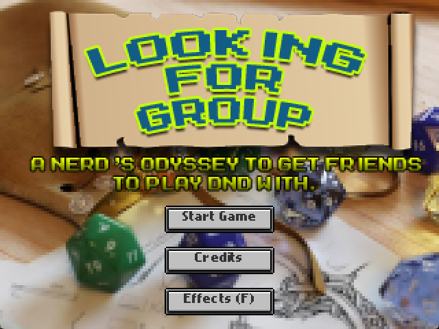
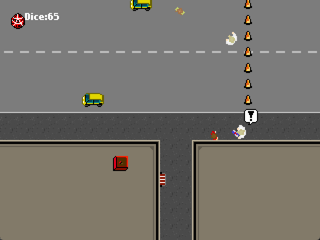
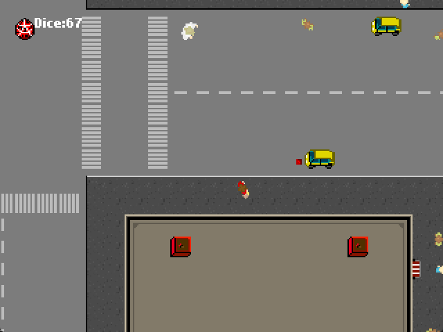
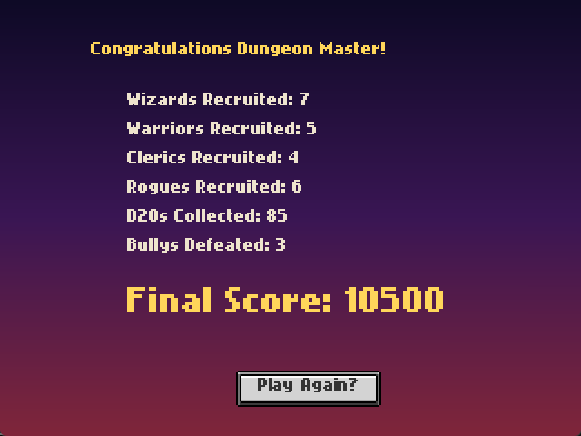
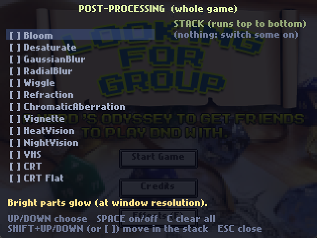

# Looking For Group

*A nerd's odyssey to get friends to play D&D with.*



**Looking For Group** is a top-down action game I made in 72 hours for [Ludum Dare 22](https://ludumdare.com/) (theme: *Alone*) and
released on [Kongregate](https://www.kongregate.com/en/games/scottychips/looking-for-group) in December 2011, with monomermusic.
This is a port of it to C# and [MonoFlixel](https://github.com/schipman/MonoFlixel), my MonoGame port of Flixel. The original was
written in ActionScript 3 with Flixel; I lost its source years ago, so this version was rebuilt from the published game.

You are a lonely nerd with a bag of magical d20s. Roll them at passers-by to recruit them into your D&D party as Warriors, Wizards,
Clerics and Rogues. Watch out for the bullies: they throw cans of Red Bull at you, take two dice to beat, and drop more dice when they go down.
Run out of dice and the campaign is over.




## Controls

| | |
|---|---|
| **W A S D** | move |
| **Mouse** | aim |
| **Left click** | throw a d20 |
| **Esc** | back to the menu (on the menu: quit) |
| **F** (menu) | the post-processing effects menu |



## Running it

You need the [.NET 8 SDK](https://dotnet.microsoft.com/download).

```
dotnet run
```

Two shortcuts for testing: `dotnet run -- --play` skips the menu, and `dotnet run -- --score` opens the end screen with sample numbers.

## Effects

The main menu has the engine's post-processing menu (Bloom, CRT, VHS, Wiggle and more). Effects stack, and your choice is remembered.



## About the code

* `Game/` is the game: states (`MainMenu`, `PlayState`, `HighScore`, `Credits`), the actors (`Player`, `Pedestrian`, `Bully`, `PedSpawner`, ...)
  and a small `Weapon` that stands in for Flixel Power Tools' `FlxWeapon`.
* `Flixel/` is the MonoFlixel engine, and `Content/` holds its shaders.
* `Assets/lfg/` has the game's images, sounds and maps. Files are named after the original `[Embed]` classes.

Changes from the 2011 version: dice and cans leave from the middle of whoever throws them, a die is only spent when one actually flies,
beaten bullies leave their sword on the ground, the end screen is a gradient with typed-out text, and there is the effects menu.

## License

The code is under the [MIT license](LICENSE). The art, music and sound effects come from the original game and are included so it runs;
they are not covered by that license. `Assets/flixel/` is from the HaxeFlixel repository (MIT).
